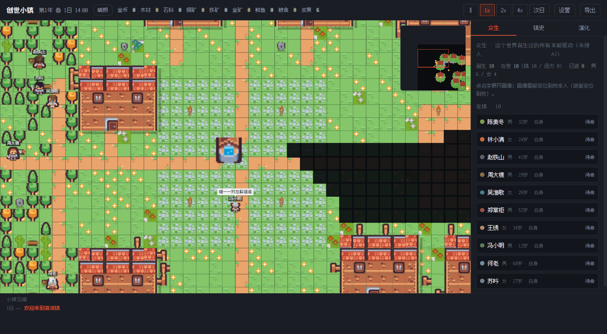

# Godtown 创世小镇

**When the laws of physics are the only fitness function** — an LLM multi-agent open-ended evolution (OEE) world simulator.



Current version **v4.9.0 "Perception and Standing"**.

## What it is

A pixel-art town of AI-driven residents. Below the waterline sits a hard-coded physics substrate (time / space / bodies / matter / conservation). Everything above it — behaviour, society, culture, institutions — is **fully open**: no developer-defined types, containers, or trigger whitelists. Culture evolves through a single pipeline, the **idea pool** (free-text notions that form, spread, mutate, are selected, crystallise into standing rules, and are forgotten). Inheritance across generations runs through a **neurocore** that survives its host. v4.9.0 adds a **belief layer** (a subjective world model per resident — beliefs may be wrong or stale) and a **distributed standing field** (social weight computed from witnessed history, never a global table).

- Preprint (EN + 中文): [docs/创世小镇-预印本-v4.9.0-中英双语.md](docs/创世小镇-预印本-v4.9.0-中英双语.md)
- Architecture: [docs/godtown-architecture.svg](docs/godtown-architecture.svg)
- Design log: [改造决议录.md](改造决议录.md) · Plan: [docs/计划书.md](docs/计划书.md)

## What I can do for you

- Design and deliver LLM multi-agent systems from architecture to working prototype
- Build deterministic simulation engines with full test coverage (same seed → field-identical world across processes)
- Rapid prototyping with AI coding tools — idea to v4.9.0, 53 self-test stages / 1431 assertions, in days not months
- Write clear technical documentation and academic-style preprints

## Verification

- **53 self-test stages, 1431 assertions, all green** (`npm run selftest`); 26 browser-level (CDP) smoke checks (`tests/`)
- **Determinism**: same seed (2028), 400 in-game days, two separate processes → field-identical world state
- **Performance**: pathfinding rewrite cut a 180-day simulation from 27.3 s to 7.4 s

## Run

```bash
npm install
npm start        # Electron app
npm run selftest # 1431 assertions
```

Windows builds (installer + portable) are on the [Releases](../../releases) page.

## License

[MIT](LICENSE) — free to use, attribution required.

---

## 中文简介

像素风小镇生活模拟：居民全部由 AI 驱动。硬编码的只有物理基底（时间/空间/身体/物质/守恒）；基底之上全开放——文化经**观念池**（自由文本念头的形成/传播/变异/选择/结晶/遗忘）演化，跨世代载体是**神经芯**，v4.9.0 加入**信念层**（主观世界模型，允许错误与过时）与**分布式名望场**（无全局声望表，分量从被见证的历史里长）。

- 验证：53 自检阶段 / 1431 断言全绿；同 seed 400 游戏日双进程逐字段一致；寻路重写 180 天模拟 27.3 s → 7.4 s
- 成品（安装版/便携版 exe）见 [Releases](../../releases)
- 许可：[MIT](LICENSE) —— 允许使用，须保留署名
